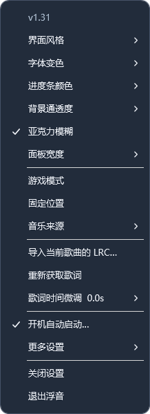

# 浮音使用指南

## 1. 安装与第一次启动

1. 在仓库 Releases 下载 `Fuyin-Windows-v1.31.zip`。页面的 Source code 是源码，不是直接运行包。
2. 完整解压到有写入权限的固定目录，例如文档下的 `Fuyin` 文件夹。保留所有脚本、DLL、图标和第三方声明，不要只复制 `Luma.exe`。
3. 双击 `Luma.exe`。它会在后台启动系统 Windows PowerShell 5.1 并显示歌词窗口。
4. 在音乐软件中播放一首歌，等待元数据与歌词完成查询。需要联网获取未缓存歌词。
5. 暂不播放时可用“设置 → 更多设置 → 预览动画与界面（演示）”查看效果；再点同一位置退出演示。

程序适用于 Windows 10 1809+ / Windows 11，未签名；如果出现系统信誉提示，请先核对下载来自本项目的 Releases。无需为运行程序关闭杀毒软件或整体修改系统执行策略；企业策略拦截时应联系设备管理员。

## 2. 连接播放器

浮音需要播放器发布 Windows 系统媒体信息（SMTC/GSMTC）。仅检测到进程或音频流，并不表示一定能取得完整歌曲和进度；它不会录下声音来识曲。

### Spotify

- 推荐使用这台电脑上的 Spotify 客户端直接播放。
- “设置 → 更多设置 → Spotify 本机播放快速响应”默认开启，用于绕过部分延迟的媒体播放状态。
- 使用 Spotify Connect 将声音放到手机、音箱或其他电脑时，关闭本机快速响应，回退到系统媒体状态；远程状态仍可能延迟。
- 多个音乐软件同时运行时，可在“音乐来源”手动选择 Spotify。选择自动模式后恢复自动挑选。

### 网易云音乐

1. 在网易云设置中查找并开启系统媒体传输控件 / SMTC 相关选项。名称和位置随客户端版本变化。
2. 从网易云托盘菜单完全退出，再重新启动并播放。
3. 浮音显示歌名但进度不动时，先查看播放器是否实际发布时间轴；打开系统媒体控件不一定补齐所有字段。
4. 必要时选择“浮音设置 → 更多设置 → 播放器适配 → 网易云：播放进度增强（64 位）…”。
5. 先完全退出网易云，选择其安装目录中的 `cloudmusic.exe`，阅读确认提示后再安装。该步骤下载固定版本 BetterNCM 1.3.4 和 InfLink-rs 3.4.0，并校验 SHA-256；不是默认启动行为。写入受保护安装目录可能需要管理员权限。
6. 安装完成后重开网易云。程序拒绝覆盖其他版本的同名组件；若已装其他 BetterNCM/插件版本，应先阅读相应上游说明。

移除时选择同一“播放器适配”菜单中的卸载项，先退出网易云。助手只移除记录为自己创建且内容未被替换的组件，并恢复它修改过的相关配置。可选组件采用各自上游许可证，详见第三方声明。

### QQ 音乐

- 在 QQ 音乐中查找“设置 → 常规设置 → 通知 → 显示系统媒体传输控件（SMTC）”，开启后完全退出重开。界面位置依版本变化。
- 完整时间轴建议尝试 21.10.2962 或更新客户端；不能保证所有后续版本行为一致。
- 浮音菜单提供连接说明，不会为 QQ 音乐自动安装额外注入组件。
- 当前项目开发阶段没有完成 QQ 音乐客户端的逐个真实播放端到端验证；离线歌词响应测试不代表整套客户端兼容已保证。

## 3. 日常操作

| 功能 | 操作 |
| --- | --- |
| 打开设置 | 右上角三个点，或右键面板 |
| 移动 | 解锁时按住面板空白处拖动 |
| 固定 | 点击锁图标或勾选“固定位置”；再次点击解锁 |
| 隐藏 | 点击右上角叉号；这不是退出 |
| 恢复 | 双击 Windows 系统托盘中的浮音图标 |
| 完全退出 | 设置中的“退出浮音”，或托盘退出项 |
| 选来源 | “音乐来源”里指定应用或使用自动选择 |
| 调整宽度 | “面板宽度”选择 520、620 或 760 DIP |

设置项点击后保持菜单打开，可以连续调整；点击外部、菜单空白或“关闭设置”收起。窗口记忆位置和设置；固定只限制拖动，不会阻止操作。



## 4. 外观与歌词颜色

- **界面风格**：月白、雾蓝、深夜。打开中的设置菜单也会跟随切换。
- **亚克力模糊**：开启时模糊窗口后方的桌面内容，关闭时使用主题实色。效果受系统透明效果、显卡、远程桌面和 Windows 版本影响。
- **背景通透度**：更透明 / 均衡 / 更浓的磨砂。通透度与模糊不是同一件事，透明不等于完全看不到底色。
- **字体变色**：默认纯白不变色，当前句更亮、下一句更暗；也可选逐字变色或整句变色。
- **逐字变色（自动）**：真实字词时间优先，缺少时使用预测。预测只知道句子的起止和文字，无法准确知道实际唱法，因此快唱、停顿、长音仍可能不准。
- **颜色**：歌词支持主题色、预设和自定义 RGB；进度条的颜色独立设置。若在纯白模式选用自定义歌词色，软件会切换到整句变色以应用颜色。
- **唱片**：使用播放器原始封面，内部图片平滑旋转，暂停时停止。没有额外中心孔和虚线；上游缩略图本身模糊时不能恢复不存在的细节。

## 5. 歌词获取、导入与微调

首次识别歌曲后自动查询，已有缓存先显示；可匹配时后台补充逐字数据，无需每次手动获取。联网来源包括网易云、QQ 音乐、KuGou 和 LRCLIB。会把必要歌曲信息发给相应来源，详见隐私说明。

### 导入 LRC

先播放并识别目标歌曲，再选择“导入当前歌曲的 LRC…”。推荐 UTF-8 编码：

```text
[00:01.500]这一句是原创示例
[00:04.200]下一句在这里出现
```

支持传统 LRC 多时间标签、`[offset:毫秒]`、增强 LRC 字词标签以及程序获取的 YRC 逐字数据。导入绑定当前歌曲。若导入歌曲与当前播放的录音不同，时间仍会错位。

“重新获取歌词”会重读缓存并触发精度查询，不等于强制删除全部缓存。需要替换文本时重新导入正确文件；清理缓存方法见常见问题。

### 固定偏差的微调

“歌词时间微调”可提前或延后 0.1 / 0.5 秒，或重置。**歌词比声音慢时选提前，歌词比声音快时选延后。** 微调是全局值，切换歌曲不会自动清零。

微调适用于整首固定偏差；一会快、一会慢通常属于句内时间数据或录音版本问题，统一提前不能彻底修复。无真实时间的预测也不保证逐字同步。

## 6. 游戏模式

勾选“游戏模式”后，确认音乐暂停时面板渐出隐藏，恢复播放时渐入。暂时从托盘恢复可查看面板；随后播放状态变化继续遵循游戏模式。

游戏模式跟随浮音检测到的播放状态，不表示独占全屏游戏一定允许覆盖。全屏、反作弊、系统合成和其他置顶窗口可能影响显示；可以尝试游戏的无边框窗口模式。

## 7. 开机自动启动

1. 先把软件放到长期保留的目录。
2. 在设置选择“开机自动启动…”，阅读对话框后确认。
3. 下次登录 Windows 进入桌面后，系统会调用启动快捷方式恢复面板；Windows 可能延迟启动，不能承诺桌面出现的同一瞬间显示。
4. 同一菜单可以关闭；也可查看 Windows 设置中的启动应用是否被禁用。

浮音只创建当前用户启动目录里的 `LumaLyrics.lnk`，指向程序目录的 `Luma.exe --startup`。默认不自动添加，不需要为自启动取得管理员权限。移动程序目录后请先关闭再重新开启，否则快捷方式可能仍指向旧目录。

创建桌面快捷方式的位置：“更多设置 → 创建桌面快捷方式”。

## 8. 更新、配置与卸载

- **更新**：从托盘完全退出旧进程，完整解压新版本，运行新 `Luma.exe`；确认设置顶部的版本号。不要只更换 EXE，界面和逻辑主要在脚本中。
- **配置/缓存**：`%LOCALAPPDATA%\LumaLyrics`，包含 `settings.json`、`lyrics/` 和按需下载的适配器暂存文件。更新通常保留设置，无需复制缓存到程序目录。
- **备份**：退出后备份上述目录。分享问题时不要直接上传整份缓存或配置。
- **卸载**：先关闭自启动；如装过可选网易云适配，先按前述方式卸载；退出浮音，删除程序文件夹。要清理个人配置时再自行删除上述本地数据目录。

需要报告问题请参阅[常见问题](常见问题.md)，不要提交音乐账号密码或 Cookie。
